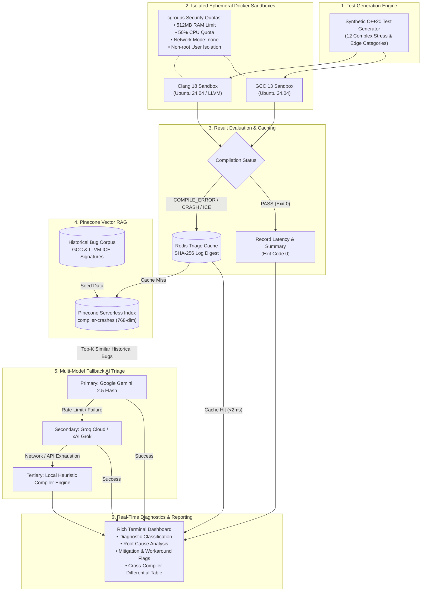

# Containerized Compiler Testbench with LLM-Driven Triage

[](https://www.python.org/downloads/)
[](https://www.docker.com/)
[-green.svg)](https://gcc.gnu.org/)
[-red.svg)](https://clang.llvm.org/)
[](https://www.pinecone.io/)
[](https://ai.google.dev/)
[](https://redis.io/)

An automated compiler stress testing and automated root-cause triage platform. This testbench dynamically generates syntactically valid yet structurally tortuous C++20 code, executes compilations inside isolated ephemeral Docker containers under strict resource quotas, detects Internal Compiler Errors (ICEs) or compilation failures, and dispatches compiler diagnostic dumps to a **Pinecone Vector RAG** and a **Multi-Model Fallback AI Triage Engine**.

---

## Architecture Overview



---

## Key Features

- **Isolated Docker Sandboxing**: Compilations execute strictly inside disposable containers with non-root security privileges, `network_mode="none"`, memory limits (`512MB`), and CPU quotas (`0.5 cores`). The host operating system remains untouched.
- **Dual-Compiler Differential Testing**: Run the exact same C++ code simultaneously across **GCC 13** and **Clang 18** to pinpoint compiler divergences, non-standard behaviors, and internal bugs.
- **Dynamic C++20 Stress Generator**: Emits complex test suites across 6 stress categories (12 specific tests):
  1. Deep Template Metaprogramming & recursive SFINAE
  2. Pointer Aliasing, Multi-dimensional Offsets & Strict Aliasing Barriers
  3. Inline Assembly & Machine Register Allocator Contention
  4. Concurrency, Atomic Memory Orderings & Sequential Consistency
  5. Tree-SSA Loop Auto-Vectorizer & SIMD unrolling limits
  6. C++20 Concepts, cyclic constraints & deep generic inlining closures
- **Pinecone Vector RAG**: Embeds compiler error logs into 768-dimensional space to query a historical corpus of real-world GCC and LLVM Internal Compiler Errors (ICEs), matching stack traces to verified bug IDs (e.g., `LLVM-61204`, `GCC-98512`).
- **Resilient Multi-Model Fallback Chain**:
  1. **Primary**: Google Gemini (`gemini-2.5-flash`)
  2. **Secondary**: Groq Cloud (`qwen/qwen3.8-27b`) or xAI Grok (`grok-2-latest`) via automatic key detection
  3. **Tertiary**: Local deterministic heuristic compiler triage engine (operates completely offline if network/APIs are exhausted)
- **Redis Triage Caching**: Identical compilation failures and crash signatures are hashed (SHA-256) and served from Redis in `< 2ms`, preventing duplicate API invocations and cost.
- **Rich Terminal UI**: Live telemetry, formatted Markdown diagnostic reports, and comprehensive pass/fail summary tables.

---

## Directory Structure

```
.
├── .env.example                     # Environment template
├── Dockerfile.gcc                   # GCC 13 sandbox container specification
├── Dockerfile.clang                 # Clang 18 / LLVM sandbox container specification
├── main.py                          # Unified CLI entry point & orchestrator
├── requirements.txt                 # Python project dependencies
├── data/
│   └── historical_bugs.json         # Seed corpus of real-world GCC & LLVM ICE bugs
├── docker/
│   ├── Dockerfile.gcc
│   └── Dockerfile.clang
├── src/
│   ├── engine/
│   │   ├── generator.py             # Synthetic C++20 stress code generator
│   │   └── runner.py                # Ephemeral Docker container compilation runner
│   ├── llm/
│   │   └── triage_agent.py          # Multi-LLM fallback chain (Gemini -> Groq/Grok -> Local)
│   ├── rag/
│   │   └── vector_store.py          # Pinecone serverless vector database integration
│   └── utils/
│       └── cache.py                 # Redis triage report caching layer
└── tests/
    ├── test_generator.py            # Unit tests for test generator logic
    ├── test_sandbox_runner.py       # Integration tests for Docker sandbox isolation
    └── verify_all_tests.py          # Full matrix validation across all 12 stress cases
```

---

## Prerequisites

1. **Docker Desktop**: Must be installed and running.
2. **Python**: Version 3.10 or higher.
3. **API Keys** (Optional but recommended for full RAG & AI triage):
   - [Pinecone API Key](https://www.pinecone.io/) (for historical bug vector retrieval)
   - [Google AI Studio API Key](https://aistudio.google.com/) (for Gemini Flash)
   - [Groq Cloud API Key](https://console.groq.com/) or [xAI Console Key](https://console.x.ai/) (for fallback triage)

---

## Installation & Setup

### 1. Clone the Repository & Setup Python Environment

```bash
git clone <repo-url>
cd "Containerized Compiler Testbench with LLM-Driven Triage"

# Create and activate virtual environment
python -m venv venv
# On Windows (PowerShell):
.\venv\Scripts\Activate.ps1
# On Linux/macOS:
source venv/bin/activate

# Install dependencies
pip install -r requirements.txt
```

### 2. Configure Environment Variables

Copy the example configuration to `.env`:

```bash
cp .env.example .env
```

Edit `.env` with your credentials:

```ini
PINECONE_API_KEY=your_pinecone_api_key_here
PINECONE_INDEX_NAME=compiler-crashes
GEMINI_API_KEY=your_gemini_api_key_here
GROK_API_KEY=your_groq_or_grok_key_here
REDIS_HOST=localhost
REDIS_PORT=6379
```

> **Note**: If `GROK_API_KEY` starts with `gsk_`, the runner automatically routes requests to **Groq Cloud** using fast Qwen/Llama models. If it starts with `xai-`, it automatically routes to **xAI Grok**.

### 3. Build Docker Sandbox Containers

Build the ephemeral compilation environments:

```bash
# Build GCC 13 Sandbox
docker build -t compiler-sandbox-gcc:latest -f docker/Dockerfile.gcc .

# Build Clang 18 Sandbox
docker build -t compiler-sandbox-clang:latest -f docker/Dockerfile.clang .
```

### 4. Start Redis Container (For Triage Caching)

```bash
docker run -d --name compiler-redis -p 6379:6379 redis:alpine
```

---

## Usage Guide

### Seed the Pinecone Vector Database
Ingest the historical compiler crash corpus (`data/historical_bugs.json`) into your Pinecone serverless vector index:

```bash
python main.py --seed-db
```

### Run Default Testbench (GCC)
Generate 4 balanced tests and execute inside the GCC container:

```bash
python main.py
```

### Run Differential Testing (GCC vs. Clang)
Execute compilations side-by-side on both compilers to detect compiler-specific divergences:

```bash
python main.py --compiler both --count 4
```

### Target Clang Exclusively
```bash
python main.py --compiler clang --count 4
```

### Choose Stress Mode
- `--mode balanced` (Default): Mix of valid complex codes and edge-case limit tests.
- `--mode aggressive`: Targets severe compiler stress and edge-case failure boundaries.
- `--mode valid-only`: Verifies that complex valid programs compile cleanly without syntax errors.

```bash
python main.py --mode aggressive --count 6
```

### Live Container Telemetry Mode
Stream container execution duration and real-time logs to the console:

```bash
python main.py --live --count 4
```

### Inject Deliberate ICE / Syntax Stress
Inject an extreme SFINAE template recursion file to explicitly verify the AI triage loop:

```bash
python main.py --inject-broken
```

---

## CLI Options Reference

| Option | Type | Default | Description |
| :--- | :--- | :--- | :--- |
| `--count` | `int` | `4` | Number of synthetic C++ tests to generate |
| `--mode` | `str` | `balanced` | Stress mode: `balanced`, `aggressive`, or `valid-only` |
| `--compiler` | `str` | `gcc` | Target sandbox: `gcc`, `clang`, or `both` |
| `--seed-db` | `flag` | `False` | Seeds `data/historical_bugs.json` into Pinecone vector store |
| `--live` | `flag` | `False` | Prints real-time container run telemetry and timing |
| `--output-dir`| `str` | `compiler_tests` | Directory to store generated test source files |
| `--inject-broken` | `flag` | `False` | Injects an intentional template recursion crash test |

---

## Verification & Automated Tests

Run the test suite to verify the generator and Docker runner:

```bash
# Verify all 12 synthetic C++ stress cases inside GCC container
python tests/verify_all_tests.py

# Run unit tests via pytest
pytest tests/ -v
```

All 12 generator test cases are verified to produce 100% deterministic expected outcomes (valid tests cleanly exit `0`, and limit stress cases cleanly emit their targeted compiler diagnostics).

---

## System Engineering Highlights

### 1. Why Ephemeral Docker Sandboxes for Compiler Testing?
- **Security & Blast Radius Isolation**: Complex C++ code featuring inline assembly, memory layout manipulation, or preprocessor expansions can trigger resource exhaustion, host segfaults, or compiler vulnerabilities.
- **Resource Containment**: With `--memory=512m` and `cpu_quota=50000`, runaway template recursions or exponential inlining cannot freeze or starve the host system.
- **Network Isolation**: Running with `network_mode="none"` prevents untrusted compilation scripts from initiating outbound network calls.

### 2. Why Differential Testing (GCC vs. Clang)?
- C++ standard specifications (ISO/IEC 14882) are written in natural language. Compiling the exact same program through both independent compiler codebases reveals:
  - Divergences in standards interpretation (e.g., C++20 Concepts constraint ordering).
  - Optimizer bugs where one compiler emits bad machine code or crashes while the other succeeds.
  - Undefined Behavior (UB) exploitation differences.

### 3. RAG-Driven Compiler Triage
- Compiler error logs and Internal Compiler Error (ICE) dumps are notoriously verbose.
- By converting error signatures into vector embeddings and performing cosine similarity lookups against known bug databases (e.g., LLVM Bugzilla, GCC Bug Tracker), the LLM is supplied with **ground-truth context**, eliminating hallucinations and outputting actionable mitigation flags in milliseconds.

---

## License

This project is licensed under the MIT License - see the LICENSE file for details.
